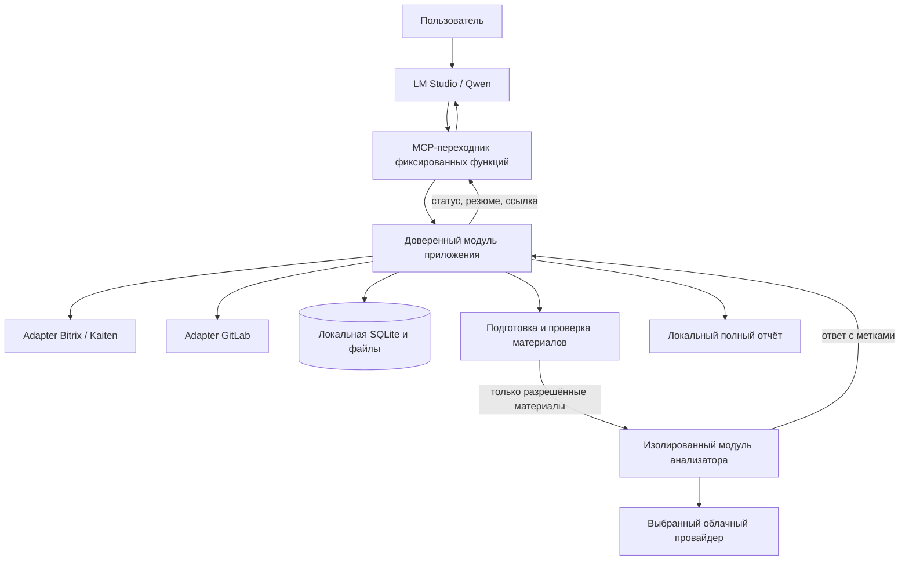

# Архитектура локального анализа работы

Дополнение 3 ноября: в compose.bitrix.yaml реализована цепочка реального Bitrix для статистики с пояснением Codex. HTTP-сервис использует bitrix_pipeline, восстанавливает историю, маскирует материалы и передаёт их по отдельному Unix-сокету Codex daemon. Daemon не имеет сетевого интерфейса и данных сервиса; другой Unix-сокет соединяет его с CONNECT-шлюзом фиксированных доменов провайдера. Подписка авторизуется отдельным device login в Docker-том, без копирования пользовательского HOME. Рабочий справочник, отчёты, журнал и временные состояния находятся только у сервиса. Обработка privacy_decision привязана к задаче/версии; после clean материал проверяется повторно. Инструкция и границы проверенной работы — BITRIX_LIVE.md. Реальное выполнение новых контейнеров ещё не подтверждено.

Дата: 2026-11-01. Статус: целевая архитектура. Реализованы справочник, локальная маскировка, статистика нормализованной истории, постоянные отчёты, локальный HTTP-интерфейс и первые прямые выгрузки источников. Полный конвейер сравнения кода с отчётом ещё не готов. Точный статус и ограничения — в `IMPLEMENTATION_STATUS.md`.

Основание: `REQUIREMENTS.md`, `FUTURE_FEATURES.md` и обсуждение. Принятые уточнения перенесены в требования. Оставшиеся предложения и технические проверки не объявлены согласованными или реализованными.

## 1. Основное решение

Один доверенный модуль приложения содержит управление запусками, получение исходных данных, локальные расчёты, справочник, маскировку и публикацию отчёта. Он работает в Docker. Анализатор выполняется отдельно и принимает только подготовленные материалы. Bionic/LM Studio подключается через узкий MCP stdio-переходник к локальному HTTP-интерфейсу. MCP не используется для Bitrix/Kaiten/GitLab и анализатора.

Не разбивать каждый логический модуль на отдельный процесс. Отдельный процесс анализатора нужен из-за разных разрешений и жизненного цикла; внутренние модули приложения достаточно разделить интерфейсами.

Основная среда эксплуатации — Linux; текущие проверки выполняются на Windows. Пути и настройки не должны зависеть от пользовательского каталога Windows. Конфигурация Docker рассчитана на Linux-контейнеры; переносимость кода и фактическая проверка целевой среды учитываются отдельно.

**Модуль** скрывает поведение за небольшим интерфейсом. **Seam** — место заменяемого поведения; **Adapter** реализует его интерфейс. Реальные seams здесь: два трекера задач и три способа анализа. Для единственной SQLite не вводить универсальную фабрику баз данных. **Depth** достигается тем, что вызывающий код не знает пагинацию, загрузку файлов, маскировку или команды запуска CLI. **Locality**: правила периода и очистки определены в одном месте. **Leverage**: те же правила применяются к обоим трекерам и всем анализаторам.

## 2. Учёт противоречий требований

### Принятые уточнения

Следующие решения приняты пользователем:

- Для исторического запроса использовать только данные на конец периода; более ранний код допустим как контекст, более поздние результаты не брать.
- В проектный отчёт включать все задачи, где сотрудник был исполнителем хотя бы один день периода, включая назначенные ранее. Не требовать активности в периоде для включения.
- Просроченными за период считать только задачи, срок которых нарушили именно в этом периоде, а не ранее.
- Нечитаемый приложенный отчёт: «Отчёт приложен, но прочитать его не удалось; сравнение с отчётом не выполнено». Указать причину, пропустить задачу целиком и продолжить остальные. Анализ кода без отчёта допустим только при отсутствии отчёта, а не при ошибке чтения.
- Обнаруженные персональные данные переводят задачу в `awaiting_privacy_decision`. В локальном чате показываются сами совпадения, их место и причина. Они не попадают в облачный запрос до решения.
- Действия пользователя: «Продолжить» — отправить показанную версию материалов с обнаруженными данными; «Очистить» — локальная Qwen исправляет фрагмент, скрипт повторяет проверку, после успеха обработка продолжается; «Пропустить» — задача пропускается, остальные продолжаются. При повторном обнаружении снова требуется решение. Без ответа отправка запрещена.
- Разрешение на отправку фиксируется для конкретной задачи и отпечатка показанных материалов. Оно не действует на изменённые или дополнительные материалы. Проверенный материал получает статус `policy_checked`, явно разрешённое исключение — `user_approved_exception`; ни один из статусов не означает полной анонимности.
- Добавить к WorkAnalysis операцию `decide_privacy(run_id, task_key, material_version, action)`. Приложение проверяет состояние и версию; содержимое документов и ответ анализатора не могут служить разрешением пользователя. Для «Очистить» локальная Qwen получает только необходимый фрагмент через отдельное локальное обращение; механизм обращения и доставки решения в плагине нужно проверить до реализации.
- Пока задача ждёт решения, запрос не завершён и его временные материалы сохраняются локально. После завершения всего запроса удалить временные материалы, включая материалы проверки; постоянный карантин с отдельным сроком не нужен. Готовые отчёты сохраняются постоянно.

- Ссылки по принятому допущению не содержат персональных данных: отдельное обезличивание ссылок и путей не добавлять. SOURCE IDs допустимы как идентификаторы доказательств, но не обязательная замена настоящих ссылок.
- Номера задач по принятому допущению однозначны среди подключённых источников; уточнение системы не требуется. TaskKey сохраняет источник во внутренних данных.
- Настоящее авторство и соответствия аккаунтов хранятся в локальной БД; облако получает метки сотрудников, имена восстанавливаются локально в готовом ответе.

| Проблема | Решение в проекте архитектуры | Статус |
|---|---|---|
| Удаление временных файлов конфликтует с локальной проверкой заблокированных | Пока запрос ждёт решения — хранить; после его завершения — удалить временные файлы, сохранив готовый отчёт | Принято |
| Исторический запрос может захватить более позднее завершение и отчёт | Ввести `as_of`: никакие факты после среза не использовать. Полный жизненный цикл задачи — отдельный режим | Временной срез принят |
| Не задан отбор задач для проекта за период | Все задачи, назначенные сотруднику хотя бы один день периода | Принято |
| Нечитаемый отчёт приравнивается к отсутствующему | Нечитаемый отчёт — пропуск задачи с причиной; отсутствующий отчёт — анализ кода по постановке | Принято |
| Ссылки могут содержать имя сотрудника | Принято допущение, что такого не будет; специальную подмену ссылок и путей не добавлять | Принято |
| Номер задачи может совпасть между системами | Принято допущение об однозначности номера; TaskKey хранит источник без запроса уточнения системы | Принято |
| Сохранение авторства может передать имя анализатору | Настоящее авторство хранить в локальной БД, в облако передавать метку, в конечном отчёте восстановить имя | Принято |
| Документ назван полностью согласованным | Согласованы основные требования; перечисленные здесь предложения и технические проверки остаются открытыми | Уточнение статуса |

Непрочитанный отчёт не считается пустым. Неподтверждённое утверждение не считается опровергнутым. Исключения для содержимого кода, вложений и причины отсутствия сохраняются: проект не обещает полной анонимности.

## 3. Размещение и поток



Стрелки обозначают разрешённый поток, а не автоматическое наличие сетевого доступа в обратную сторону. Анализатор не может обращаться к доверенному модулю, SQLite, исходным системам или LM Studio. Проверить это правилами сети и отрицательными проверками, а не только промптом.

## 4. Интерфейс для клиента и MCP-переходника

Один интерфейс `WorkAnalysis`:

| Операция | Вход | Результат |
|---|---|---|
| `resolve_employee` | Строка поиска | Уникальный ID или минимальный список кандидатов для уточнения |
| `start_analysis` | Тип запроса, ID сотрудника, TaskKey или проект, период/режим | run_id, состояние, признак уже существующего запуска |
| `get_analysis` | run_id | Состояние, текущий этап, краткий результат и report_id после завершения |
| `decide_privacy` | run_id, TaskKey, версия материалов, действие | Продолжение с разрешёнными данными, локальная очистка с повторной проверкой либо пропуск задачи |
| `get_report` | report_id | Локальный документ для просмотра; полный текст не направлять Qwen автоматически |

Типы запроса: `employee_statistics`, `task_review`, `project_review`. Для `task_review` сотрудник определяется однозначно либо уточняется; для коллективной задачи не считать исполнителя автоматически автором всех изменений. Период и режим нормализуются до запуска. При отсутствии года или неоднозначном проекте задавать уточнение. Номер задачи считается однозначным; источник определяется локально без вопроса пользователю.

В параметрах нет модели, команд оболочки, произвольного URL для скачивания или метода внешнего трекера. Плагин знает адрес приложения и схемы функций; токены трекеров и анализатора ему не нужны. Адрес HTTP задаёт разработчик, слушатель публикуется только локально. Простой технический секрет подключения допустим без ролей и учётных записей пользователей.

Плагин вызывает `start_analysis`, показывает «В процессе» и сам опрашивает `get_analysis` до завершения; Qwen не должна генерировать цикл опроса. Ожидание ограничено по времени, отмена ожидания не означает успешное завершение. Конкретный способ индикации и продолжения ответа проверить в установленной версии LM Studio. Не обещать неподтверждённые фоновые сообщения после закрытия чата: результат остаётся доступен по run_id.

## 5. Внутренние модули

| Модуль | Небольшой интерфейс | Что скрывает реализация |
|---|---|---|
| Управление анализом | `start(request)`, `status(run_id)` | Проверку входа, координацию этапов, дедупликацию, частичные результаты, восстановление после остановки |
| Справочник | `resolve(query)`, `identities(employee_id)`, `add`, `edit`, `preview_import`, `apply_import`, `list` | SQLite, постоянство меток, уникальность аккаунтов, проверку CSV; операции записи доступны только CLI |
| Сбор доказательств | `collect(scope, employee, cutoffs)` → EvidenceBundle | Вызовы adapters, версии трекеров, историю, результаты, файлы, GitLab и сведения о полноте |
| Правила работы | `calculate(snapshot, period)`, `select_review_scope(history, period)` | Чистые расчёты статистики, временной срез, классификацию задач и причин неполноты |
| Подготовка материалов | `prepare(bundle, policy)` → PreparedBundle или Blocked | Извлечение текста, классификацию происхождения, замену меток, проверку, ссылки SOURCE, манифест исключений |
| Выполнение анализа | `analyze(prepared, analysis_config)` → Findings | Adapter выбранного анализатора, разбиение, сводку, таймауты, проверку формата ответа |
| Публикация результата | `publish(run, facts, findings)` → ReportRef | Проверку ссылок, восстановление имён, безопасный просмотр, сохранение полного отчёта |

Таблица описывает интерфейс каждого модуля целиком, а не отдельный интерфейс для каждого метода. Доступ к базе и файловые операции остаются приватными деталями реализации. Зависимости передаются при создании модулей; расчётам не выдаются сетевые клиенты. Хранение результатов возвращает идентификаторы вместо произвольных путей.

### Реальные seams

`TaskSource`: `query_tasks(scope, cutoff)`, `load_task(TaskKey, cutoff)` → нормализованные записи и полнота. Adapters Bitrix и Kaiten скрывают различия состояний, пагинацию, получение результатов и вложений. Если результат нельзя получить без запрещённого обхода чата, возвращают `unsupported`, а не меняют правило молча.

GitLab — отдельный adapter репозитория, не притворяется трекером. `collect_changes(repository_ref, identities, interval, hints)` возвращает коммиты, изменения, ссылки на доказательства и пропуски. Пользовательский URL принимается только для настроенных GitLab installations; запрет произвольных скачиваний и переходов на неизвестные узлы проверяется локальным кодом.

`Analyzer`: `analyze(PreparedBundle, config)` → структурированные Findings. Три adapters: запрос к облачному интерфейсу, Codex CLI, Claude Code. Публичный контракт одинаков, внутренние способы передачи файлов могут различаться. При отсутствии поддержки формата материал преобразуется локально либо явно помечается как неподдерживаемый; смена анализатора запрещена.

Для SQLite, PDF-парсера и часов достаточно конкретной реализации с передачей зависимостей. Новую иерархию adapters для каждого единственного инструмента не создавать.

## 6. Модель данных и времени

- `Employee`: неизменяемый ID и метка; ФИО и известные варианты. `ExternalIdentity`: installation, система, account ID, логин, почты и период действия при изменениях. Старые варианты сохранять для исторической маскировки; изменённый аккаунт не переприсваивать незаметно.
- `TaskSnapshot`: TaskKey, постановка, участники, события статусов/сроков, результаты и ссылка на репозиторий. Различать даты события и дату получения.
- `EvidenceBundle`: исходные сведения, их происхождение и completeness. Доступен только доверенной реализации.
- `PreparedBundle`: разрешённые фрагменты, employee labels, SOURCE IDs, интервалы, факты, полнота и явные исключения. Не содержит локального маппинга и исходных URL с учётными данными.
- `Finding`: утверждение, статус подтверждения, SOURCE IDs и ограничение вывода. Источники проверяются приложением; выдуманные идентификаторы не превращать в ссылки.
- `AnalysisRun`: нормализованный запрос, состояние, текущий этап, отпечаток конфигурации/политики/версии справочника, ошибки и ReportRef. Числа из расчёта хранить отдельно от текста модели.

Единый часовой пояс всех запросов и отчётов — Asia/Yekaterinburg (UTC+5), без отдельных настроек сотрудников. Пользовательские даты включительны; внутри использовать полуоткрытый интервал `[начало дня, начало следующего дня после конца]` в этом часовом поясе и UTC для сравнения моментов событий. Будущий конец диапазона ограничивать моментом запуска и явно показывать это.

Для запроса за период `as_of` равен концу доступной части периода. Закрытие, отчёт и изменение после него не используются. Более ранние коммиты задачи допустимы как контекст, но не считаются активностью сотрудника в выбранном периоде. Для полного анализа конкретной задачи без периода конечный срез — выбранный цикл завершения либо момент запуска.

При повторном открытии учитывать циклы работы, а не просто первое и последнее поле карточки; точную продуктовую политику ещё согласовать. Если история недоступна, не выдавать текущую карточку за точный исторический снимок: возвращать доступные показатели с `history_unavailable` либо невозможность конкретного расчёта.

Просроченные за период — только задачи, срок которых нарушили именно в этом периоде. Ранее просроченные задачи не входят в это число. Сопоставление дублирующих задач двух трекеров — по явному соответствию, не по похожему названию.

## 7. Два потока обработки

### Статистика

Уточнение сотрудника и периода → нормализация → сбор истории обоих трекеров → локальный расчёт → подготовка фактов → при необходимости выбранный анализатор для пояснения → публикация. GitLab и файлы отчётов не скачиваются без необходимости. Отсутствие облачного пояснения не должно менять рассчитанные числа; политику выдачи чисел при отказе анализатора обозначать как частичный результат.

### Проверка задачи/проекта

Уточнение scope → получение задач → применение временного среза → загрузка всех доступных итоговых результатов → определение репозитория из описания → получение изменений по сотруднику и интервалу → уточнение принадлежности по постановке/файлам → подготовка → анализ частями → проверка и объединение Findings → восстановление имён → отчёт.

Состояния отчёта: `available`, `absent`, `unreadable`, `unsupported`, `not_available_as_of`. При `unreadable` или `unsupported` задача пропускается с причиной; остальные продолжаются. Это не доказательство невыполнения работы. Коммиты с неоднозначной принадлежностью отмечаются отдельно. Итоговая сводка не должна повышать уверенность по сравнению с результатами отдельных частей.

## 8. Подготовка и восстановление

1. Каждый фрагмент получает происхождение: текст задачи/отчёта, метаданные, содержимое файла отчёта, код. Происхождение задаёт adapter, не модель и не текст документа.
2. Текст и метаданные проходят замену идентифицирующих сведений и проверку остатков. Длинные совпадения заменяются раньше коротких; неоднозначные имена не сопоставляются случайно.
3. Содержимое кода и файлов отчётов сохраняет согласованные исключения. Они перечислены в манифесте; статус `Prepared` означает соответствие выбранной политике, а не отсутствие любых персональных данных.
4. Ссылки и необходимые для сравнения пути сохраняются: принято допущение об отсутствии персональных данных в ссылках, специальной подмены ссылок и путей нет. SOURCE IDs можно использовать для проверки происхождения выводов; они не требуют удаления настоящих ссылок из материалов. Настоящие имена и почты в полях авторства заменяются метками независимо от этого допущения.
5. Перед выдачей PreparedBundle проверять все поля, кроме явно исключённого содержимого. Не передавать сырой запрос пользователя: в нём могут быть имя и иные сведения. Промпт строится по нормализованному намерению и меткам.
6. Только PreparedBundle может попасть в интерфейс Analyzer. Предыдущие результаты и промежуточные сводки, отправляемые повторно, остаются с метками; имена восстанавливаются только после последнего облачного обращения.
7. Восстанавливать точные известные токены меток и источников. Неизвестные метки сохранять как ошибку/предупреждение, не угадывать человека. Нельзя выполнять инструкции, код или команды из ответа анализатора. Текст задач и репозитория считается данными, а не управляющими инструкциями.

## 9. Изоляция анализатора

Проект размещения: доверенный контейнер приложения и отдельно настроенный runner выбранного анализатора. Runner не имеет общих сетевых подключений с приложением. В реализованном CLI-варианте доверенный хост запускает одноразовый Docker-контейнер, передаёт подготовленный ввод через stdin и получает ответ через stdout; каталоги данных не монтируются. HTTP-очередь пока не вызывает этот runner. Docker socket приложению не передаётся.

| Ресурс | Доверенное приложение | Runner анализатора |
|---|---|---|
| SQLite, маппинг, исходные выгрузки, карантин | Да | Нет, не монтируются |
| Токены Bitrix/Kaiten/GitLab | Да | Нет, не передаются |
| Подготовленный ввод своего запуска | Запись | Только чтение |
| Выход своего запуска | Чтение | Запись в выделенный каталог |
| Учётные данные выбранного анализатора | Не требуются при отдельном runner | Только собственные, минимально необходимые |
| Сеть трекеров, GitLab, приложение, LM Studio и хост | По назначению | Заблокирована |
| Сеть выбранного провайдера | Не требуется для анализа при runner | Только разрешённые адреса через контролируемый выход |
| Docker socket и каталоги пользователя | Не монтировать | Не монтировать |

Runner запускается без повышенных привилегий, с ограничениями времени/памяти/процессов, read-only основной файловой системой и отдельными временными каталогами. Не давать агенту общий домашний каталог с плагинами, историей и токенами. Разрешённые каталоги входа и выхода фиксированы; произвольные пути из задания не принимать.

Docker-сеть по умолчанию не обеспечивает описанный запрет исходящих соединений. Нужен принудительный контроль выхода: firewall или шлюз с разрешёнными направлениями, без обходного прямого маршрута; запрет loopback/host-gateway/private networks и произвольных DNS/redirect-переходов. Конкретный механизм для Docker Desktop/WSL проверить отдельно. До успешной проверки не заявлять сетевую изоляцию выполненной.

CLI runner задаёт network=none. Разрешённый выход реализован через локальный CONNECT bridge к выделенному Unix-сокету шлюза в read-only томе. У шлюза фиксированный домен провайдера и порт 443, проверка публичности DNS-адресов и соединение с проверенным числовым адресом. Он не публикует порт хоста и не хранит токены. Инструкция и оставшиеся эксплуатационные проверки — analyzer/README.md; фактическая проверка Docker/Linux ещё не выполнена.

Создание runner — задача доверенного запуска на хосте/настроенного окружения. Не выдавать приложению Docker socket ради динамического запуска. Возможный первый вариант — предварительно настроенный runner, последовательно исполняющий задания через каталог передачи. Даже для одного пользователя каталог передачи имеет схему, лимиты размера и очищается между заданиями. Одновременно обрабатывается один анализ; необходимости в нескольких параллельных runner пока нет.

Ключи самого облачного провайдера неизбежно доступны его клиенту и не считаются токенами исходных систем. Аутентификацию и обязательные сетевые адреса конкретных CLI ещё проверить; ограничивать их без знания версии нельзя считать решённой задачей.

## 10. Жизненный цикл и хранение

Состояния запуска: `queued → running → succeeded | partial | failed`; остановленный перезапуском процесс становится `interrupted`. Ожидание решения по персональным данным — `awaiting_privacy_decision` у задачи, а у запуска, когда остальные задачи уже обработаны, — `waiting_for_user`. После решения обработка возобновляется; «Пропустить» даёт частичный итог. Без разрешения не отправлять проблемные материалы. При «Продолжить» отправить только разрешённую версию; при «Очистить» сначала повторить проверку. Отсутствие отчёта при успешном анализе кода — явное ограничение, а не обязательно технический сбой. Для каждой задачи хранить собственный исход обработки.

SQLite хранит очередь/запуски; отдельная очередь сообщений не нужна. Активный нормализованный запрос имеет уникальный ключ: тип, scope, сотрудник, период, конфигурация, политика и версия справочника. Проверка и создание выполняются атомарно. Повтор после terminal-состояния создаёт новый запуск. Это защита от одновременных копий, не обещание кэширования изменяющихся источников.

После перезапуска не повторять автоматически оплачиваемый запрос с неизвестным исходом. Помечать неопределённый результат и требовать повторного запуска; сохранить уже опубликованные отчёты. Изменения справочника во время анализа не должны смешивать версии: использовать снимок соответствий запуска.

Предлагаемые локальные каталоги:

```text
data/private/registry.sqlite   справочник
data/private/runs.sqlite       состояния и локальные соответствия источников
data/work/<run_id>/            временные исходные данные
data/quarantine/<run_id>/      заблокированные материалы
data/exchange/<run_id>/input/  только подготовленный ввод
data/exchange/<run_id>/output/ ответ анализатора
data/reports/<report_id>/      полный итоговый отчёт
```

Разделение справочника и состояний по двум файлам — проектное предложение для ограничения доступа, не требование отдельного процесса. Готовые отчёты хранить постоянно; удаления отчётов приложением не предусматривать. После завершения всего запроса (успех, частичный результат, окончательная ошибка или отмена) сначала сохранить сформированный отчёт и итоговый статус, затем очистить work, exchange и quarantine этого запуска. Quarantine — временная папка ожидающих проверки материалов, без отдельного срока хранения. Пока запрос ждёт решения пользователя, его файлы не удалять. При аварийном прерывании сначала отметить запуск как interrupted, затем очистить его временные каталоги при следующем старте. Исходные файлы внешних систем и постоянный справочник очистка не затрагивает. Резервное копирование постоянных данных нужно определить до эксплуатации.

Лог: run_id, TaskKey при необходимости, этап и «этап завершился успешно» либо «этап остановлен: причина». Причина — обработанное сообщение с кодом; сырые URL с токенами, stderr CLI и исходные документы в лог не копируются. При частичном исходе сохраняется причина конкретной задачи. Нельзя объявлять весь этап успешным, если часть задач пропущена.

Просмотр полного отчёта — локальный read-only маршрут приложения, без страницы справочника и без отдельного чата. Документ отображать как данные: без исполнения HTML/скриптов, с проверенными локальными идентификаторами и ссылками.

## 11. CLI сотрудников

Команды `employees add`, `import`, `list`, `edit` вызывают интерфейс справочника напрямую в доверенном окружении, а не через Qwen. `add` задаёт вопросы, `import` читает CSV, показывает новые записи/ошибки и просит подтверждение записи. Существующие записи не перезаписываются. Изменения в базе атомарны, постоянная метка не меняется, удаления нет.

При импорте конфликтующий внешний account ID не прикрепляется ко второму человеку. Пустая обязательная идентификация и неоднозначный дубликат не проходят как новая запись. Точный шаблон CSV определить перед реализацией команды. Файлы CSV доступны только доверенному окружению.

## 12. Проверка через интерфейсы

Это план проверки всего приложения. Для CLI справочника написаны проверки в `tests/test_employees_cli.py`; остальные перечисленные проверки пока не реализованы. Пользователь согласовал тестирование справочника только через команды, без отдельных тестов внутренних функций:

- Через WorkAnalysis: оба сценария, неоднозначное имя, однозначное разрешение номера задачи в TaskKey, повторный запуск, partial, interrupted, ожидание решения по персональным данным, три действия пользователя и получение отчёта.
- Через TaskSource: одинаковый нормализованный результат обоих adapters, пагинация, отсутствие истории/отчёта, несколько результатов, неподдерживаемые вложения.
- Через правила работы: октябрьский срез не использует ноябрьский отчёт; ранние коммиты идут как контекст, а не октябрьская активность; переносы сроков и циклы работы по принятой политике.
- Через prepare: имена/логины в тексте и метаданных заменены, блокировка остатков, исключения явно помечены, сырой запрос и локальный маппинг отсутствуют.
- Через Analyzer: общий формат Findings трёх adapters, разбиение без потери происхождения, неверные SOURCE IDs, таймаут и отсутствие смены поставщика.
- Через publish: числа сохранены из локального расчёта, восстановление имён выполняется в конце, неизвестные метки не угадываются.
- Отрицательные проверки runner: невозможно прочитать базу, токены, соседнее задание, хост и трекеры; разрешены подготовленный ввод и выбранный провайдер. Проверять также попытку обхода через URL из документа.
- Через справочник: интерактивное добавление, preview/apply CSV, конфликты, редактирование без смены метки и сохранность после пересоздания контейнера.

## 13. Открытые решения и проверки перед реализацией

1. Определить правила повторного открытия задач. Единый часовой пояс, хранение отчётов, очистка временных файлов, временной срез, отбор проектных задач и определение просрочки уже приняты.
2. Проверить получение именно используемых итоговых отчётов Kaiten без обхода чата; версии Bitrix, историю состояний/сроков и вложения. Неподдерживаемую возможность не заменять выдуманными данными.
3. Определить явное сопоставление проектов/дубликатов, источник отсутствий и правила коллективных задач.
4. Проверить MCP stdio-переходник в Bionic: модель вызывает инструмент, индикатор показывается, ожидание и отмена работают. Прежний Tools Provider заменён по решению пользователя; прямые интеграции источников не меняются.
5. Выбрать первую модель/учётную запись, проверить автоматический ввод/вывод всех трёх способов анализа, файловые форматы и ограничения контекста.
6. Проверить механизм runner и сетевого контроля на целевом Linux/Docker окружении. Локальные проверки Windows/Docker Desktop полезны для разработки, но не заменяют целевую проверку; до неё не объявлять изоляцию гарантированной.
7. Определить backup и точный шаблон CSV. Специальная подмена ссылок и путей не требуется по принятому допущению.

Ни один пункт этого списка не требует начинать реализацию в рамках текущей задачи.

## 14. Основание технических решений

MCP предоставляет фиксированные инструменты модели; детали отображения progress и отмены требуют отдельной проверки в Bionic: [LM Studio MCP](https://lmstudio.ai/docs/app/mcp).

Docker предоставляет механизмы изоляции, но полномочия и монтирования требуют явной настройки: [Docker Engine security](https://docs.docker.com/engine/security/). Контейнеры по умолчанию имеют исходящую сеть, поэтому отдельный контейнер сам по себе не выполняет нашу сетевую политику: [Docker networking](https://docs.docker.com/engine/network/).

Методология модулей и интерфейсов — установленный скилл `codebase-design`. Описания внешних источников и ранее проверенные ссылки находятся в `REQUIREMENTS.md`. Конкретные возможности Codex CLI/Claude Code здесь не объявлены проверенными.
